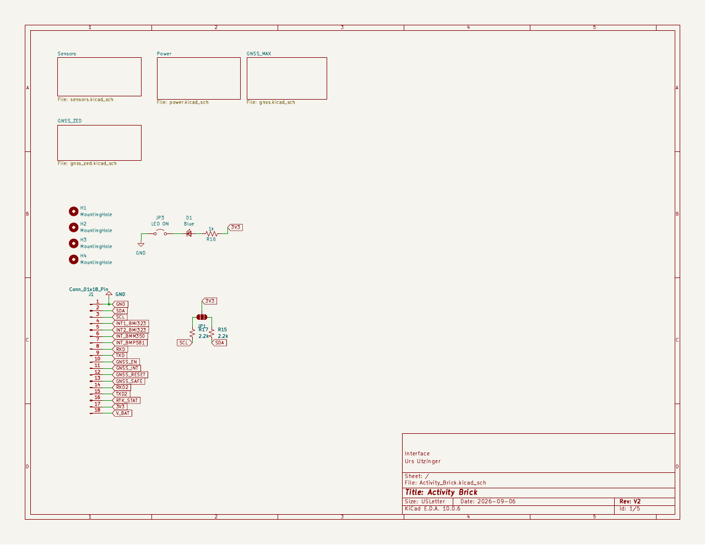
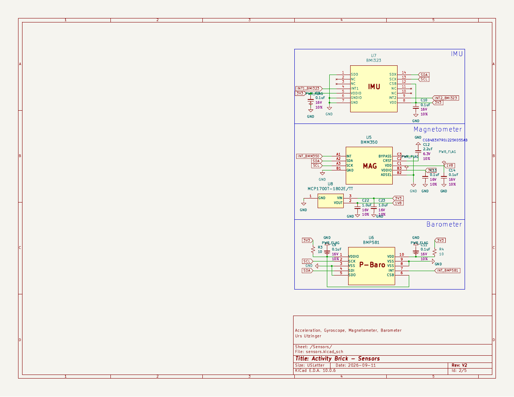
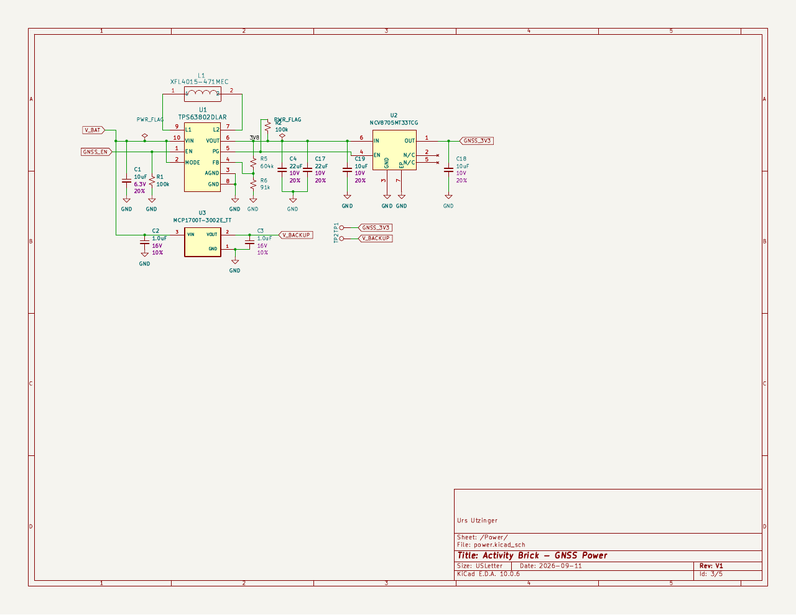
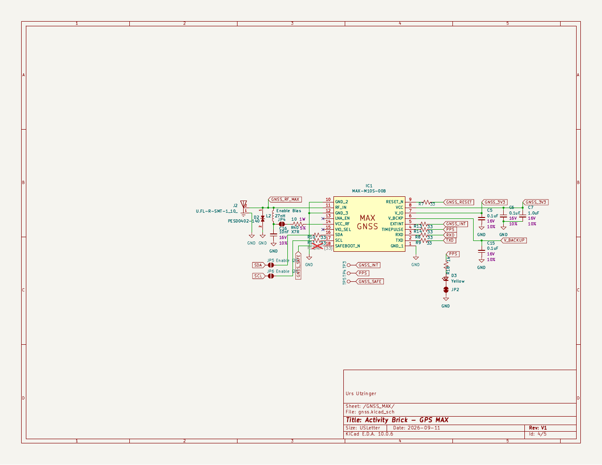
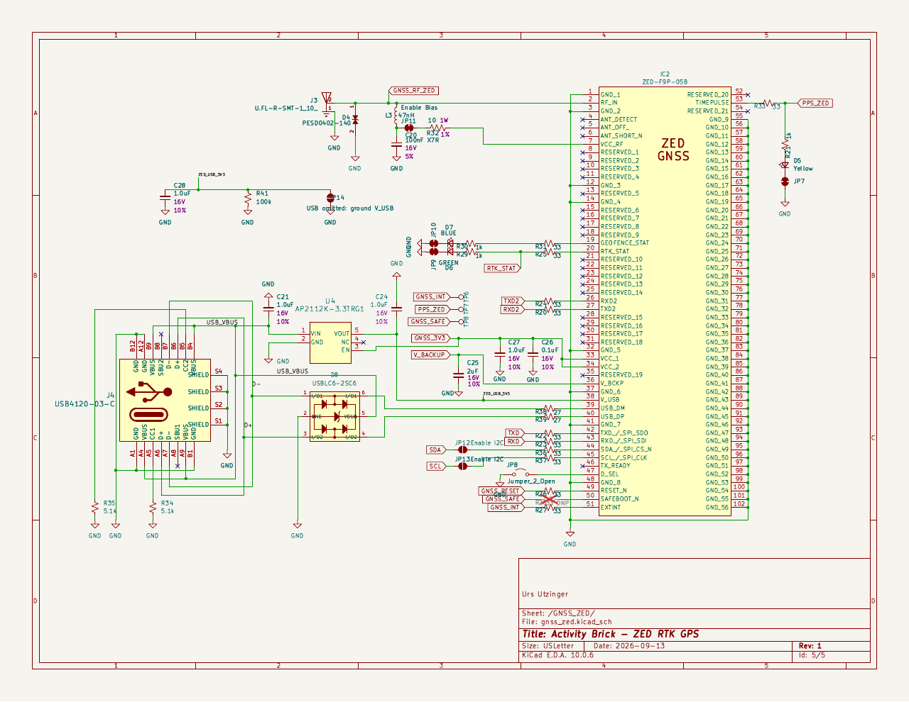
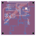
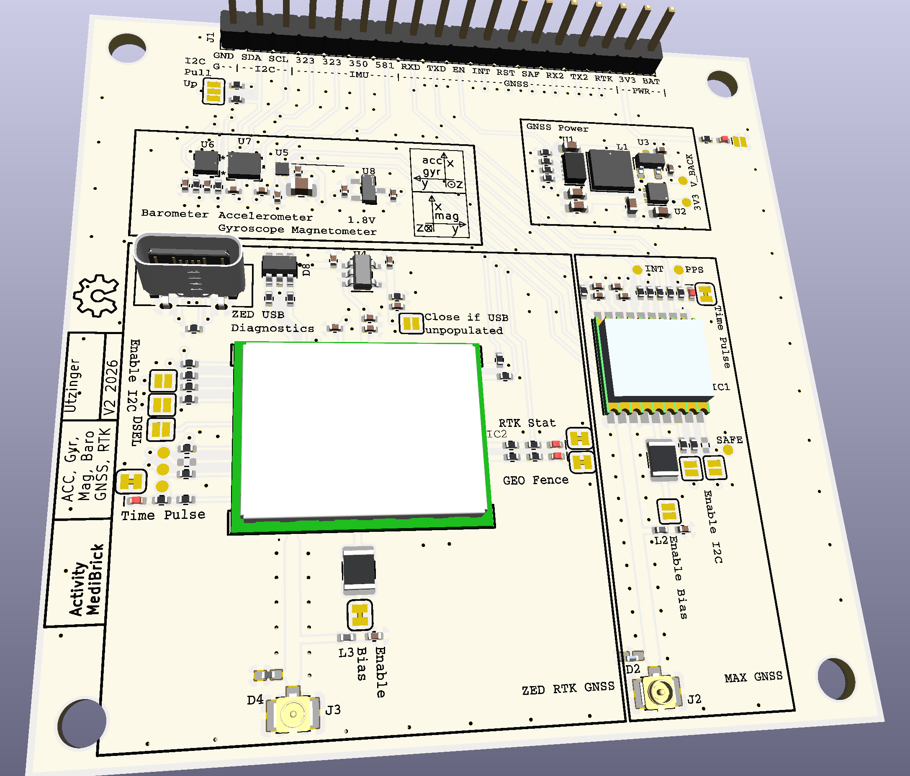
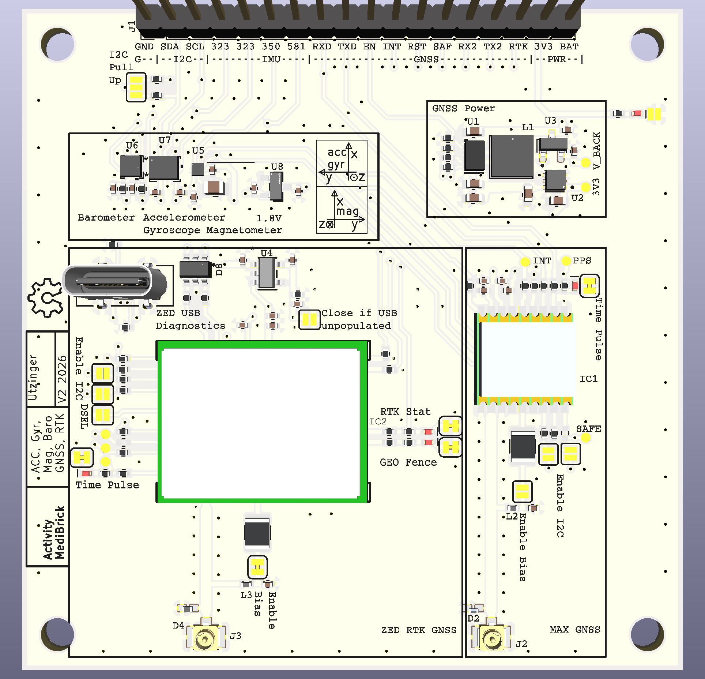

# Activity Brick V2

Electronics design for the Activity Brick V2: an IMU + magnetometer +
barometer + optional GNSS/RTK sensor board that plugs into an Adafruit
Feather ESP32-S3 host. See [v1](../v1/README.md) for the earlier generation
of this board.

## Components

- IMU: [Bosch Sensortec BMI323](https://www.bosch-sensortec.com/en/products/motion-sensors/imus/bmi323)
- Magnetometer: [Bosch Sensortec BMM350](https://www.bosch-sensortec.com/en/products/motion-sensors/magnetometers/bmm350)
- Barometer: [Bosch Sensortec BMP581](https://www.bosch-sensortec.com/en/products/environmental-sensors/pressure-sensors/bmp581)
- Standard GNSS assembly option: [u-blox MAX-M10S-00B](https://www.u-blox.com/en/product/max-m10-series?legacy=Current)

or 

- RTK GNSS assembly option: [u-blox ZED-F9P-05B](https://www.u-blox.com/en/product/zed-f9p-module) (mutually exclusive with MAX-M10S)

The design will not operate with both GPS systems populated at the same time. Populating USB connection for ZED RTK GPS is optional.

Datasheets for all selected parts are under [datasheets/](datasheets/).

## Status

Design completed.

## Design

### Schematics

The root schematic connects the Feather host interface to the sensor, power,
MAX-M10S, and ZED-F9P hierarchical sheets. MAX-M10S and ZED-F9P are mutually
exclusive assembly options and retain independent antenna paths.

<table>
  <tbody>
    <tr>
      <td align="center"><strong>Interface and interconnect</strong> </td>
      <td align="center"><strong>BMI323, BMM350, and BMP581 sensors</strong> </td>
    </tr>
    <tr>
      <td align="center"><strong>Power supplies</strong> </td>
      <td align="center"><strong>MAX-M10S GNSS assembly option</strong> </td>
    </tr>
    <tr>
      <td align="center"><strong>ZED-F9P RTK GNSS assembly option</strong> </td>
      <td align="center"><strong>PCB front and back copper</strong> </td>
    </tr>
  </tbody>
</table>

### Simulated View

<table>
  <thead>
    <tr>
      <th>Perspective view</th>
      <th>Top view</th>
    </tr>
  </thead>
  <tbody>
    <tr>
      <td align="center"></td>
      <td align="center"></td>
    </tr>
  </tbody>
</table>

## Manufacturing

The fabrication Gerbers, plated and non-plated drill files, and KiCad Gerber
job file are in [KiCAD/Gerber/](KiCAD/Gerber/). The layer set includes front
and back copper, solder mask, paste, silkscreen, and the board outline.

The raw KiCad bill of materials is [Activity_Brick.csv](Activity_Brick.csv).
The working procurement and assembly-variant workbook is
[Activity_Brick_Production_BOM.xlsx](Activity_Brick_Production_BOM.xlsx).

## KiCad Project

The KiCad 10 project lives in [KiCAD/](KiCAD/), using unpacked project-local
symbol, footprint, and 3D-model libraries under `KiCAD/symbols/`,
`KiCAD/footprints/`, and `KiCAD/3dmodels/`. See
[KiCAD/README.md](KiCAD/README.md) for details.

## Documents

- [Activity Brick V2 Design.md](Activity%20Brick%20V2%20Design.md): Main design document: components, power supply/logic domains, power budget, GNSS antenna options and selection guidance
- [IMU Options.md](IMU%20Options.md): Survey and comparison of candidate IMU/magnetometer/GNSS parts and the final selection rationale.
- [Datasheets, Footprints, Symbols, 3D.md](Datasheets,%20Footprints,%20Symbols,%203D.md): Acquisition of symbols, footprints, and 3D models, with per-part status
- [KiCAD/README.md](KiCAD/README.md): KiCad project layout and how to create/use project-local design blocks
- [AGENTS.md](AGENTS.md): Conventions for working on this design (library formats, verification, ERC/DRC requirements)
